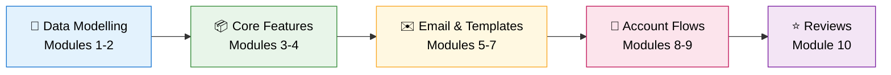

<div align="center">

# ⚡ FastAPI Full Course: Zero to Production-Ready Backend

### Part 1: Foundations, Auth & Async · Part 2: Relations, Migrations, Email & Real-World Features


<br>

| 🎬 Part 1 | 🎬 Part 2 |
|:-:|:-:|
| [](https://www.youtube.com/watch?v=CG4WyImo72s) | [](https://www.youtube.com/watch?v=hj81HI2AsG4) |
| **[Watch Part 1](https://www.youtube.com/watch?v=CG4WyImo72s)** | **[Watch Part 2](https://www.youtube.com/watch?v=hj81HI2AsG4)** |

<sub>👆 Click a thumbnail to watch the full course on YouTube</sub>

</div>

---

## 📖 About This Course

This repository is the companion code for the **FastAPI Full Course series**, a project-driven path from API basics to a production-style backend.

| Part | What you build | Length | Modules | Code folders |
|:-:|:--|:-:|:-:|:-:|
| **Part 1** | A secure, database-backed, asynchronous REST API with registration, OAuth2 + JWT login, and Redis-powered logout | ~10 hrs | 14 | `m01` – `n11` |
| **Part 2** | Real-world backend features: SQL relationships, Alembic migrations, delivery partners, product events, email sending, email verification, password reset, Jinja templates, and reviews | 8.5+ hrs | 10 | `n12` – `n20` |

Every module builds on the previous one, so you won't just learn FastAPI's features. You'll understand **how they fit together in a real backend**.

> 🎯 **Who is this for?**
> Python developers, aspiring backend engineers, and AI engineers who want to build APIs for real-world applications.
> **Part 2 assumes you know the Part 1 material** (FastAPI basics, SQLModel, async, and JWT auth). If you don't, start with Part 1.

---

## 🗺️ The Learning Roadmap

```mermaid
flowchart LR
    A["🌐 Foundations<br/>Modules 1-2"] --> B["🧩 Core API Skills<br/>Modules 3-5"]
    B --> C["✅ Data Validation<br/>Module 6"]
    C --> D["🗄️ Databases<br/>Modules 7-8"]
    D --> E["⚡ Async & Cloud DB<br/>Modules 9-10"]
    E --> F["🏗️ Architecture<br/>Module 10.1"]
    F --> G["🔐 Security<br/>Modules 11-11.2"]

    style A fill:#e3f2fd,stroke:#1976d2,color:#000
    style B fill:#e8f5e9,stroke:#388e3c,color:#000
    style C fill:#fff8e1,stroke:#f9a825,color:#000
    style D fill:#fce4ec,stroke:#c2185b,color:#000
    style E fill:#f3e5f5,stroke:#7b1fa2,color:#000
    style F fill:#e0f7fa,stroke:#00838f,color:#000
    style G fill:#ffebee,stroke:#c62828,color:#000
```

### Part 1



### Part 2



| Part | Stage | What You'll Master | Modules |
|:-:|:--|:--|:--:|
| 1 | 🌐 **Foundations** | What APIs are, why FastAPI, and a clean dev environment | 1 – 2 |
| 1 | 🧩 **Core API Skills** | Type hints, path & query parameters, your first full CRUD API | 3 – 5 |
| 1 | ✅ **Data Validation** | Pydantic models, schemas, and bulletproof request/response validation | 6 |
| 1 | 🗄️ **Databases** | SQL fundamentals, SQLAlchemy, SQLModel, and database integration | 7 – 8 |
| 1 | ⚡ **Async & Cloud DB** | Async IO, asynchronous APIs, PostgreSQL on Supabase | 9 – 10 |
| 1 | 🏗️ **Architecture** | Structuring a growing codebase with API Routers | 10.1 |
| 1 | 🔐 **Security** | Registration, OAuth2 password flow, JWT login, Redis-based logout | 11 – 11.2 |
| 2 | 🔗 **Data Modelling** | One-to-many and many-to-many SQL relationships, safe schema changes with Alembic | 1 – 2 |
| 2 | 📦 **Core Features** | Delivery partners and product events built end to end | 3 – 4 |
| 2 | ✉️ **Email & Templates** | Sending email, Jinja HTML templates, custom response classes | 5 – 7 |
| 2 | 🔐 **Account Flows** | Email verification and password reset | 8 – 9 |
| 2 | ⭐ **Reviews** | A product review feature that ties the backend together | 10 |

---

## 📚 Course Curriculum

### 🎬 Part 1: Foundations, Auth & Async

📺 **[Watch Part 1 on YouTube](https://www.youtube.com/watch?v=CG4WyImo72s)**

| # | Module | Timestamp | Approx. Length | Level |
|:-:|:--|:--:|:--:|:--:|
| 1 | **Introduction to APIs and FastAPI** | [`00:04:19`](https://www.youtube.com/watch?v=CG4WyImo72s&t=259s) | ~14 min | 🟢 Beginner |
| 2 | **Environment Setup** | [`00:18:22`](https://www.youtube.com/watch?v=CG4WyImo72s&t=1102s) | ~8 min | 🟢 Beginner |
| 3 | **Type Hints & Path Parameters** | [`00:26:23`](https://www.youtube.com/watch?v=CG4WyImo72s&t=1583s) | ~53 min | 🟢 Beginner |
| 4 | **Query Parameters** | [`01:19:31`](https://www.youtube.com/watch?v=CG4WyImo72s&t=4771s) | ~26 min | 🟢 Beginner |
| 5 | **Build a CRUD API** | [`01:45:05`](https://www.youtube.com/watch?v=CG4WyImo72s&t=6305s) | ~13 min | 🟡 Intermediate |
| 6 | **Pydantic for Data Validation** | [`01:57:44`](https://www.youtube.com/watch?v=CG4WyImo72s&t=7064s) | ~1 hr 48 min | 🟡 Intermediate |
| 7 | **SQL Database** | [`03:46:08`](https://www.youtube.com/watch?v=CG4WyImo72s&t=13568s) | ~1 hr 3 min | 🟡 Intermediate |
| 8 | **SQLAlchemy, SQLModel & Database Integration** | [`04:49:10`](https://www.youtube.com/watch?v=CG4WyImo72s&t=17350s) | ~1 hr 10 min | 🟡 Intermediate |
| 9 | **Async IO and Asynchronous APIs** | [`05:58:58`](https://www.youtube.com/watch?v=CG4WyImo72s&t=21538s) | ~33 min | 🔴 Advanced |
| 10 | **PostgreSQL (Supabase) + FastAPI** | [`06:31:32`](https://www.youtube.com/watch?v=CG4WyImo72s&t=23492s) | ~34 min | 🔴 Advanced |
| 10.1 | **API Routers** | [`07:05:44`](https://www.youtube.com/watch?v=CG4WyImo72s&t=25544s) | ~43 min | 🔴 Advanced |
| 11 | **Authentication: Register** | [`07:48:48`](https://www.youtube.com/watch?v=CG4WyImo72s&t=28128s) | ~47 min | 🔴 Advanced |
| 11.1 | **OAuth2 Password Flow & JWT Tokens: Login** | [`08:35:57`](https://www.youtube.com/watch?v=CG4WyImo72s&t=30957s) | ~1 hr 19 min | 🔴 Advanced |
| 11.2 | **Logout (Redis Database)** | [`09:55:10`](https://www.youtube.com/watch?v=CG4WyImo72s&t=35710s) | ~5 min+ | 🔴 Advanced |

### 🎬 Part 2: Relations, Migrations, Email & Real-World Features

📺 **[Watch Part 2 on YouTube](https://www.youtube.com/watch?v=hj81HI2AsG4)**

| # | Module | Timestamp | Approx. Length | Level |
|:-:|:--|:--:|:--:|:--:|
| 0 | **Introduction & What We're Building** | [`00:00:00`](https://www.youtube.com/watch?v=hj81HI2AsG4&t=0s) | ~3 min | 🟡 Intermediate |
| 1 | **SQL Relations** | [`00:02:40`](https://www.youtube.com/watch?v=hj81HI2AsG4&t=160s) | ~34 min | 🟡 Intermediate |
| 2 | **Alembic: DB Migrations** | [`00:36:33`](https://www.youtube.com/watch?v=hj81HI2AsG4&t=2193s) | ~26 min | 🟡 Intermediate |
| 3 | **Delivery Partner** | [`01:02:25`](https://www.youtube.com/watch?v=hj81HI2AsG4&t=3745s) | ~2 hr 26 min | 🔴 Advanced |
| 4 | **Product Event** | [`03:28:15`](https://www.youtube.com/watch?v=hj81HI2AsG4&t=12495s) | ~1 hr 21 min | 🔴 Advanced |
| 5 | **Send Mail** | [`04:48:54`](https://www.youtube.com/watch?v=hj81HI2AsG4&t=17334s) | ~1 hr 10 min | 🔴 Advanced |
| 6 | **Jinja Template (HTML + FastAPI)** | [`05:58:29`](https://www.youtube.com/watch?v=hj81HI2AsG4&t=21509s) | ~30 min | 🔴 Advanced |
| 7 | **Response Classes** | [`06:28:30`](https://www.youtube.com/watch?v=hj81HI2AsG4&t=23310s) | ~25 min | 🔴 Advanced |
| 8 | **Email Verification** | [`06:53:31`](https://www.youtube.com/watch?v=hj81HI2AsG4&t=24811s) | ~57 min | 🔴 Advanced |
| 9 | **Password Reset** | [`07:50:23`](https://www.youtube.com/watch?v=hj81HI2AsG4&t=28223s) | ~38 min | 🔴 Advanced |
| 10 | **Product Review** | [`08:28:29`](https://www.youtube.com/watch?v=hj81HI2AsG4&t=30509s) | Final module | 🔴 Advanced |

---

## 🧭 Module-by-Module Guide

## Part 1

<details>
<summary><b>🌐 Stage 1: Foundations (Modules 1-2)</b></summary>

### Module 1: Introduction to APIs and FastAPI
- What an API is and how clients and servers communicate
- REST concepts: HTTP methods, status codes, JSON
- Why FastAPI: speed, automatic docs, type-driven design

### Module 2: Environment Setup
- Python environment and dependency management
- Installing FastAPI and an ASGI server
- Running your first app and exploring the auto-generated docs

**✅ Outcome:** A working FastAPI project running locally.
</details>

<details>
<summary><b>🧩 Stage 2: Core API Skills (Modules 3-5)</b></summary>

### Module 3: Type Hints & Path Parameters
- Python type hints and why FastAPI relies on them
- Defining and validating path parameters
- Automatic documentation driven by your types

### Module 4: Query Parameters
- Optional and required query parameters
- Defaults, filtering, searching, and pagination patterns
- Validating query input

### Module 5: Build a CRUD API
- Create, Read, Update, Delete endpoints
- Applying HTTP methods and status codes correctly
- Your first end-to-end working API

**✅ Outcome:** A complete CRUD API you can test from the interactive docs.
</details>

<details>
<summary><b>✅ Stage 3: Data Validation (Module 6)</b></summary>

### Module 6: Pydantic for Data Validation
- Defining request and response models
- Field constraints, validators, and nested models
- Separating input schemas from output schemas
- Returning clean, predictable, well-documented responses

**✅ Outcome:** An API that rejects bad data automatically and documents itself.
</details>

<details>
<summary><b>🗄️ Stage 4: Databases (Modules 7-8)</b></summary>

### Module 7: SQL Database
- Relational database fundamentals
- Writing SQL queries
- Tables, relationships, and data modelling

### Module 8: SQLAlchemy, SQLModel & Database Integration
- Using an ORM instead of raw SQL
- SQLAlchemy and SQLModel models
- Sessions and dependency injection
- Connecting your CRUD API to a real database

**✅ Outcome:** A persistent API backed by a real database.
</details>

<details>
<summary><b>⚡ Stage 5: Async & Cloud Database (Modules 9-10)</b></summary>

### Module 9: Async IO and Asynchronous APIs
- Synchronous vs asynchronous execution
- `async` / `await` in Python
- Writing non-blocking endpoints and database calls

### Module 10: PostgreSQL (Supabase) + FastAPI
- Provisioning a managed PostgreSQL database with Supabase
- Connecting FastAPI to a cloud database
- Moving from local development toward production-style infrastructure

**✅ Outcome:** An async API connected to a hosted PostgreSQL database.
</details>

<details>
<summary><b>🏗️ Stage 6: Architecture (Module 10.1)</b></summary>

### Module 10.1: API Routers
- Splitting a growing app into modular routers
- Organizing endpoints, schemas, and models
- Building a maintainable project structure

**✅ Outcome:** A clean, scalable codebase ready for authentication.
</details>

<details>
<summary><b>🔐 Stage 7: Security (Modules 11-11.2)</b></summary>

### Module 11: Authentication, Register
- User registration flow
- Password hashing and secure credential storage

### Module 11.1: OAuth2 Password Flow & JWT Tokens, Login
- OAuth2 password flow in FastAPI
- Creating and verifying JWT access tokens
- Protecting routes with dependencies

### Module 11.2: Logout (Redis Database)
- Why stateless JWTs need a logout strategy
- Using Redis to manage token invalidation

**✅ Outcome:** A complete authentication system: register, login, protected routes, and logout.
</details>

## Part 2

<details>
<summary><b>🔗 Stage 8: Data Modelling (Modules 1-2)</b></summary>

### Module 1: SQL Relations
- Modelling one-to-many and many-to-many relationships in SQL
- Defining relationships between your SQLModel tables
- Querying related data

### Module 2: Alembic, DB Migrations
- Why `create_all` isn't enough once your app has real data
- Generating and applying migrations safely
- Evolving your schema without losing data

**✅ Outcome:** A relational schema you can change safely over time.
</details>

<details>
<summary><b>📦 Stage 9: Core Features (Modules 3-4)</b></summary>

### Module 3: Delivery Partner
- Building the delivery partner feature end to end
- Models, relationships, schemas, and routes working together
- Extending your existing auth system to a new type of user

### Module 4: Product Event
- Building the product event feature end to end
- Tracking changes to a product over time
- Applying the relationships and migrations from earlier modules

**✅ Outcome:** Multi-entity backend features built on a real relational schema.
</details>

<details>
<summary><b>✉️ Stage 10: Email & Templates (Modules 5-7)</b></summary>

### Module 5: Send Mail
- Sending emails from FastAPI
- Configuring a mail service and keeping credentials out of your code

### Module 6: Jinja Template (HTML + FastAPI)
- Rendering HTML pages with Jinja templates
- Passing data from your endpoints into templates

### Module 7: Response Classes
- Returning custom responses beyond plain JSON
- Choosing the right response class for the job

**✅ Outcome:** An API that can send email and serve HTML as well as JSON.
</details>

<details>
<summary><b>🔐 Stage 11: Account Flows (Modules 8-9)</b></summary>

### Module 8: Email Verification
- Confirming a user's email address after registration
- Generating and validating verification links

### Module 9: Password Reset
- A complete forgot-password and reset flow
- Sending reset links and handling the reset page

**✅ Outcome:** Production-style account flows on top of your JWT authentication.
</details>

<details>
<summary><b>⭐ Stage 12: Reviews (Module 10)</b></summary>

### Module 10: Product Review
- Building a product review feature
- Bringing together relationships, auth, and validation in one feature

**✅ Outcome:** A feature-complete, real-world backend.
</details>

---

## 🛠️ Tech Stack

| Layer | Technology |
|:--|:--|
| **Framework** | FastAPI |
| **Language** | Python 3 |
| **Validation** | Pydantic |
| **ORM** | SQLAlchemy, SQLModel |
| **Migrations** | Alembic |
| **Database** | PostgreSQL (hosted on Supabase) |
| **Concurrency** | Async IO (`async` / `await`) |
| **Auth** | OAuth2 Password Flow, JWT |
| **Cache / Token Store** | Redis |
| **Templates** | Jinja |
| **Email** | Transactional email from FastAPI (verification and password reset) |

---

## 💼 Skills Demonstrated

*A quick view for recruiters and hiring managers.*

- ✅ Designing and building **RESTful APIs** with FastAPI
- ✅ **Data validation and serialization** with Pydantic
- ✅ **Relational database design** and SQL, including **one-to-many and many-to-many relationships**
- ✅ **ORM-based persistence** with SQLAlchemy and SQLModel
- ✅ **Database migrations** with Alembic
- ✅ **Asynchronous programming** for high-throughput services
- ✅ Working with **managed PostgreSQL** (Supabase)
- ✅ **Modular architecture** using API Routers
- ✅ **Secure authentication**: password hashing, OAuth2, JWT
- ✅ **Token invalidation** using Redis
- ✅ **Email sending**, **email verification**, and **password reset** flows
- ✅ **Custom response classes** and **Jinja-rendered HTML** from FastAPI
- ✅ Building **real-world features**: delivery partners, product events, and reviews
- ✅ Using **auto-generated OpenAPI documentation** for testing and collaboration

---

## 📂 Repository Structure

Each folder is one module of the course, so you can open the code for the exact lesson you're watching.

| Folder | Part | Covers |
|:--|:-:|:--|
| `m01 Introduction` | 1 | Introduction to APIs and FastAPI |
| `m02 Getting Started` | 1 | Environment setup |
| `m03 Path Params` | 1 | Type hints & path parameters |
| `m04 Query Params` | 1 | Query parameters |
| `m05 CRUD API` | 1 | Build a CRUD API |
| `m06 Pydantic` | 1 | Pydantic for data validation |
| `m07 SQL Database` | 1 | SQL database |
| `m08 SQL Model` | 1 | SQLAlchemy, SQLModel & database integration |
| `m09 AsyncIO` | 1 | Async IO and asynchronous APIs |
| `m10 Postgres` | 1 | PostgreSQL (Supabase) + FastAPI |
| `n11 Authentication` | 1 | Register, login (OAuth2 + JWT), and logout |
| `n12 SQL Relations` | 2 | SQL relationships |
| `n13 Alembic` | 2 | Database migrations |
| `n14 DeliveryPartner` | 2 | Delivery partner feature |
| `n15 Event Product` | 2 | Product event feature |
| `n16 Send Mail` | 2 | Sending email from FastAPI |
| `n17 Response Classes` | 2 | Custom response classes |
| `n18 Email Verification` | 2 | Email verification flow |
| `n19 Reset Password` | 2 | Password reset flow |
| `n20 Review` | 2 | Product review feature |

---

## 🚀 Getting Started

### Prerequisites
- Python 3.10+
- Basic Python knowledge (functions, classes, dictionaries)
- A code editor such as VS Code
- For Part 2: familiarity with Part 1 (FastAPI basics, SQLModel, and JWT authentication)
- Optional: a free [Supabase](https://supabase.com) account (Part 1, Module 10 onward) and Redis (Part 1, Module 11.2)
- Optional: an email account or SMTP service for testing Part 2's email modules (Send Mail, Email Verification, Password Reset)

### Setup

```bash
# 1. Clone the repository
git clone https://github.com/AsadullahShehbaz/FastAPI-and-Backend-Development-Course.git
cd FastAPI-and-Backend-Development-Course

# 2. Create and activate a virtual environment
python -m venv venv
source venv/bin/activate        # macOS / Linux
venv\Scripts\activate           # Windows

# 3. Install dependencies
pip install -r requirements.txt

# 4. Move into the module you want to run and start the dev server
cd "n12 SQL Relations"
uvicorn app.main:app --reload
```

> 💡 Modules with an `app/` folder are run from inside their module folder. Part 1's earlier modules use `uvicorn main:app --reload`.

### Working with migrations (Part 2, Alembic)

```bash
# Generate a migration after changing your models
alembic revision --autogenerate -m "describe your change"

# Apply all pending migrations
alembic upgrade head
```

Then open:
- **Interactive docs (Swagger UI):** http://127.0.0.1:8000/docs
- **Alternative docs (ReDoc):** http://127.0.0.1:8000/redoc

---

## 🎓 How to Get the Most From This Course

1. **Follow the modules in order.** Each one depends on the last.
2. **Code along.** Pause the video and type it yourself.
3. **Break things on purpose.** Send invalid data and read the errors.
4. **Use `/docs` constantly.** It's your testing playground.
5. **Finish each module's outcome** before moving to the next stage.
6. **Compare with the repo.** If your code differs from the video, check the matching module folder.

---

## 🔭 What's Next

Parts 1 and 2 are live. **Part 3 is coming soon**, with more advanced FastAPI concepts.

⭐ **Star this repo** to get notified when new parts land.

---

## 👨‍💻 About the Instructor

**Asadullah Shehbaz**
Full Stack AI Engineer & Educator · Ex-Kaggle GM

Subscribe to **Asadullah AI** for practical AI engineering, backend development, and MLOps.

[](https://linkedin.com/in/asadullahai)
[](https://github.com/AsadullahShehbaz)
[](https://x.com/asadullahgenai)
[](https://www.instagram.com/asad_ullahshehbaz/)
[](https://web.facebook.com/profile.php?id=61576230402114)

---

<div align="center">

**If this course helped you, give the repo a ⭐ and share it with a friend who is learning backend development.**

`#FastAPI` `#Python` `#BackendDevelopment`

</div>
